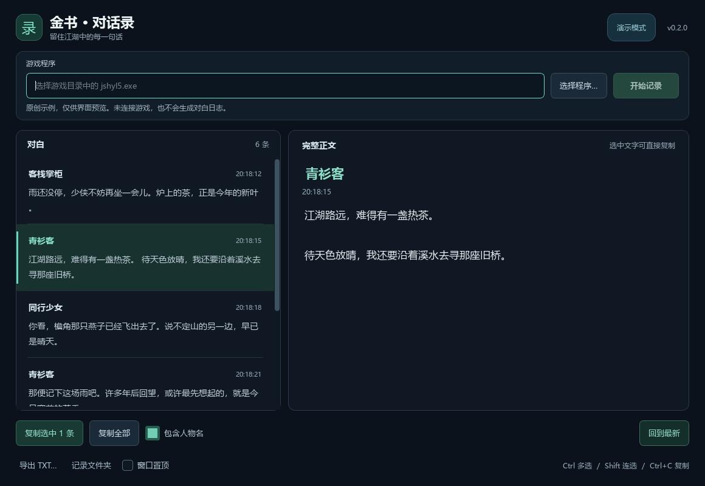

# 金书对话录

[](https://github.com/460649891/jinshu-dialogue/actions/workflows/windows.yml)
[](https://github.com/460649891/jinshu-dialogue/releases/latest)
[](LICENSE)

把《金书红颜录》的标准人物对话实时显示为可选择、复制和导出的文字。桌面版使用 PySide6，支持游戏路径选择、多条复制和阅读历史时保持滚动位置。



截图使用原创演示文字，不包含游戏对白或存档。

## 快速使用

1. 从 [正式版本下载页](https://github.com/460649891/jinshu-dialogue/releases/latest) 下载 `JinshuDialogue-0.2.0-windows-x64.zip`，**完整解压**到可写文件夹。
2. 双击文件夹中的 `JinshuDialogue.exe`，无需安装 Python。
3. 在界面中选择游戏主程序 `jshyl5.exe`，按提示连接游戏。可先启动游戏，也可先打开本工具。
4. 触发一段新的标准人物对话。选择一条或多条记录后，使用复制按钮或 `Ctrl+C`；可切换复制时是否包含人物名。

查看历史时，新消息继续保存，列表保持当前阅读位置；点击“回到最新”恢复跟随。关闭工具会停止采集，游戏可继续运行。

每次采集会持续写入 UTF-8 TXT 和 JSONL 文件，默认位于应用旁的 `对话记录/`。个人设置保存在应用的数据目录中；应用目录不可写时回退到 `%LOCALAPPDATA%\JinshuDialogue`。保留完整文件夹结构，勿单独移动 EXE 或删除 `_internal/`。程序不会自动覆盖剪贴板。

## 支持范围

- 平台：Windows 10（1809 及以上）/ Windows 11 x64，参见 [Qt 6.12 官方平台要求](https://doc.qt.io/qt-6.12/windows.html)；当前适配的游戏进程为 x86。此次实机验收环境为 Windows 11。
- 游戏：《金书红颜录》5.60C，主程序 SHA-256：

  ```text
  e4648b2055cc09edd6166e29095bfeed7e576c09c5e11d77c7dacda81235521e
  ```

- 选择路径时会校验整个主程序。其他版本需要单独适配，不应修改哈希值强行连接。
- 主要面向标准人物对话。特殊剧情窗口、战斗提示、菜单和其他版本尚不保证完整支持。
- 启动前已经显示的旧对白不保证补抓；请切换到下一句确认采集。
- 无法确认当前人物时显示“未知人物”。相同文字的不同逻辑对话允许分别保存，正常重绘合并为同一条。
- 本项目不含游戏程序、DLL、资源包、对白、存档或语音播放功能。

## 常见问题

**无法连接：** 确认选择的是受支持版本的 `jshyl5.exe`，只运行一个目标游戏进程。游戏和工具的运行权限需一致；通常都以普通用户运行即可。

**连接后没有文字：** 触发新的标准人物对话，并查看界面状态。特殊窗口可能尚未适配。

**人物或去重异常：** 记录出现问题的窗口类型、操作顺序及是否出现“同一句连续两次”，通过仓库 Issues 报告。

**打不开 EXE：** 确认已完整解压，并保留 `_internal/`。问题报告中注明 Windows 版本及安全软件提示。

## 开发

文档入口：[架构与采集原理](docs/architecture.md) · [开发指南](docs/development.md) · [版本兼容](docs/compatibility.md) · [发布流程](docs/releasing.md) · [文档规范](docs/documentation.md) · [参与贡献](CONTRIBUTING.md)。

需要 Python **3.12 x64**；Node.js 仅用于原生事件分类测试。运行依赖和构建工具分别锁定在 `requirements.txt`、`requirements-build.txt`。

在项目目录使用 PowerShell：

```powershell
py -3.12 -m venv .venv
.\.venv\Scripts\python.exe -m pip install -r requirements-build.txt
.\.venv\Scripts\python.exe src\gui.py
```

不依赖本机固定盘符。真实采集通过 GUI 选择游戏路径；适配描述位于 `profiles/`。

### 离线演示与测试

演示模式使用项目原创示例，不连接游戏：

```powershell
.\.venv\Scripts\python.exe src\gui.py --demo
.\.venv\Scripts\python.exe src\gui.py --demo --smoke-test
.\.venv\Scripts\python.exe scripts\check_docs.py
.\.venv\Scripts\python.exe -m unittest discover -s tests -v
node tests/test_agent.js
```

无桌面的测试环境可设置 `$env:QT_QPA_PLATFORM = 'offscreen'`。单元测试、演示和 CI 不连接真实游戏；真实版本的适配仍需要人工验证。

## 构建 Windows 免安装包

在 Windows x64 上安装上述构建依赖后运行：

```powershell
powershell -ExecutionPolicy Bypass -File scripts\build.ps1
# 可指定 Python 和输出目录；相对路径以项目根目录为准
powershell -ExecutionPolicy Bypass -File scripts\build.ps1 -Python .venv\Scripts\python.exe -OutputDir release
```

构建采用 PyInstaller `onedir`，GUI 入口为 `src/gui.py`，关闭控制台窗口。中间产物位于 `.build/`；`release/` 包含：

- `JinshuDialogue-0.2.0-windows-x64.zip`：可运行文件夹、README、许可证和第三方声明。
- `JinshuDialogue-0.2.0-source.zip`：按允许清单收集的源码和构建材料。
- `SHA256SUMS`：两个 ZIP 的 SHA-256 校验值。

只生成源码包或预览文件清单：

```powershell
.\.venv\Scripts\python.exe scripts\package_source.py --list
.\.venv\Scripts\python.exe scripts\package_source.py --output release\JinshuDialogue-0.2.0-source.zip
```

源码包明确排除环境、游戏文件、诊断工具、个人配置、对话记录及内部计划。构建脚本不会运行真实采集。GitHub Actions 在 Windows 上执行离线测试并上传构建 artifact，不自动创建公开 Release。

## 工作原理

Frida 在游戏进程内临时监听已适配的文字更新与绘制入口，读取人物名和正文，再由 Python 按逻辑对话事件配对、去重并保存。GUI 使用后台采集线程，主线程负责阅读和复制。原文按游戏编码解码后，以 UTF-8 保存。

程序不使用截图 OCR，不修改游戏程序、素材或存档；退出采集时解除本次连接。资源由 `src/agent.js`、`src/theme.qss`、`assets/` 与 `profiles/` 提供，发行版在 `_internal/` 中保留对应相对路径。

## 问题报告与许可

普通问题请使用 [Bug report 表单](https://github.com/460649891/jinshu-dialogue/issues/new?template=bug_report.yml)，填写工具版本、Windows 版本、游戏主程序 SHA-256、复现步骤、预期和实际表现。提供截图或日志前，请删除个人路径、游玩对白及其他私人内容；无需上传游戏 EXE、DLL 或存档。安全漏洞请按 [安全报告说明](SECURITY.md) 私下提交。

本项目代码采用 [MIT 许可证](LICENSE)。第三方依赖保留各自许可，详见 [THIRD_PARTY_NOTICES.md](THIRD_PARTY_NOTICES.md)；免安装包的 `LICENSES/` 中附许可正文和来源信息。
